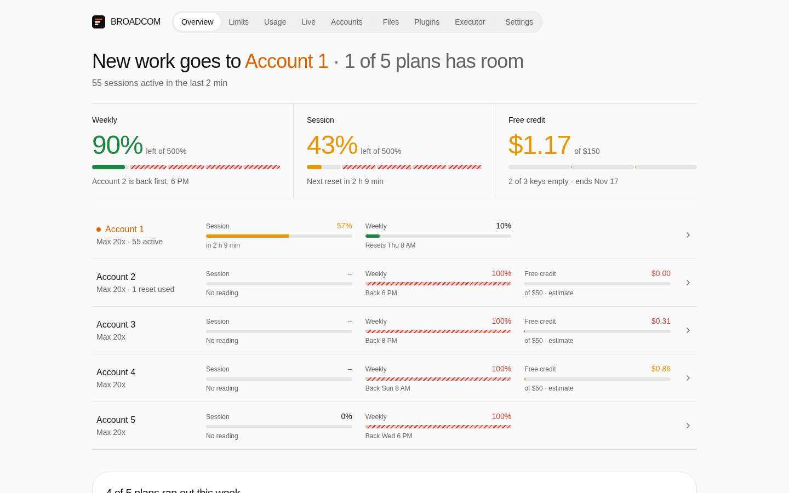
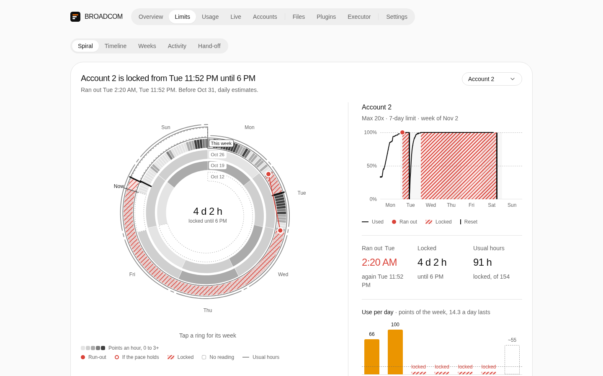
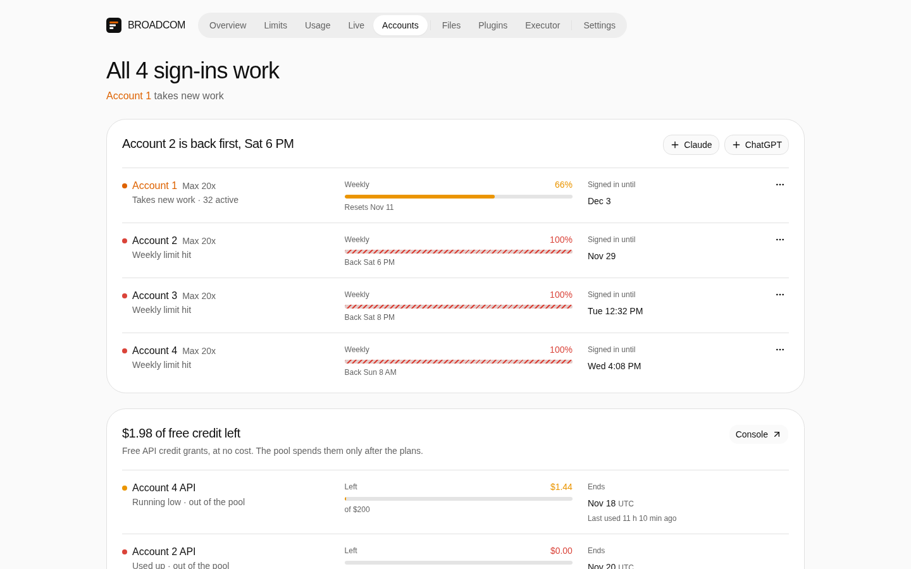

# BROADCOM

A Claude account pool and its dashboard: where new work goes, what every plan and free API credit has left, how fast it's being spent, and by whom.

<picture>
  <source media="(prefers-color-scheme: dark)" srcset="docs/screenshots/overview-dark.png">
  
</picture>

<table>
  <tr>
    <td width="50%"><picture>
        <source media="(prefers-color-scheme: dark)" srcset="docs/screenshots/limits-dark.png">
        
      </picture></td>
    <td width="50%"><picture>
        <source media="(prefers-color-scheme: dark)" srcset="docs/screenshots/accounts-dark.png">
        
      </picture></td>
  </tr>
  <tr>
    <td align="center">Limits</td>
    <td align="center">Accounts</td>
  </tr>
</table>

## Run a pool

On the machine that holds your Claude logins, macOS or Linux:

```sh
curl -fsSL https://github.com/AVGVSTVS96/broadcom/releases/latest/download/install.sh | sh
```

It installs the pool, the usage service and the dashboard in `~/.local/share/broadcom`, asks you to sign in a Claude account, and starts all three. The dashboard is at http://127.0.0.1:4840, and its Accounts page adds more accounts. `broadcom` starts them again later.

Point Claude Code here at it:

```sh
BROADCOM_KEY=$(head -1 ~/.config/broadcom-proxy/client-keys) broadcom connect http://127.0.0.1:8317
```

To reach it from other machines, set `listen` in `~/.config/broadcom-proxy/config.json` to an address they can reach ([config](crates/proxy#config)).

Run one pool per set of logins: two pools signed in to the same accounts rotate each other's refresh tokens and sign each other out.

## Use a pool

On any other machine:

```sh
curl -fsSL https://github.com/AVGVSTVS96/broadcom/releases/latest/download/install.sh | sh -s -- connect https://pool.example.com
```

Or `broadcom connect <url>` where it's installed. It asks for one of the pool's client keys (agents set `BROADCOM_KEY`), checks the pool takes it, sets `ANTHROPIC_BASE_URL` and `ANTHROPIC_AUTH_TOKEN` in `~/.claude/settings.json`, and has Claude Code answer once through the pool. It works the same with a [CLIProxyAPI](https://github.com/router-for-me/CLIProxyAPI) pool.

The pool alone is also on crates.io: `cargo install broadcom-proxy`. [Its README](crates/proxy) covers config and running it as a service.

## Develop

| Folder                         | What it is                                                                                              |
| ------------------------------ | ------------------------------------------------------------------------------------------------------- |
| [`apps/web`](apps/web)         | the dashboard, for a [CLIProxyAPI](https://github.com/router-for-me/CLIProxyAPI) pool or broadcom-proxy |
| [`crates/proxy`](crates/proxy) | broadcom-proxy: one address for all your Claude subscriptions                                           |
| [`crates/usage`](crates/usage) | broadcom-usage: collects agent usage and answers the dashboard's Usage views                            |

Next.js 16, shadcn on Base UI, Tailwind 4, Effect 4.

```sh
bun install
BROADCOM_PROXY=http://127.0.0.1:8317 bun --filter @broadcom/web dev
```

`BROADCOM_KEY_FILE` points at the proxy's management key (default `~/.config/broadcom/key`). The key stays on the server.

### Add pages

A folder at `apps/web/app/(extension)` adds pages to the dashboard. It's a Next.js [route group](https://nextjs.org/docs/app/api-reference/file-conventions/route-groups): its folders are routes, `pages.ts` puts them in the nav, and `package.json` brings their dependencies.

```
apps/web/app/(extension)/
├── pages.ts          the nav entries
├── package.json      { "name": "notes", "dependencies": { … } }
├── notes/page.tsx    /notes
└── lib/notes.ts      imported as @extension/lib/notes
```

```ts
import type { Page } from "@/components/shell/nav";

export const pages: readonly Page[] = [{ href: "/notes", name: "Notes" }];
```

Its code imports the dashboard's like any page does (`@/components/viz/section`). The folder is git-ignored; `scripts/deploy.sh` copies in the one `BROADCOM_EXTENSION` names, from the environment or `~/.config/broadcom/env`, before it builds.
