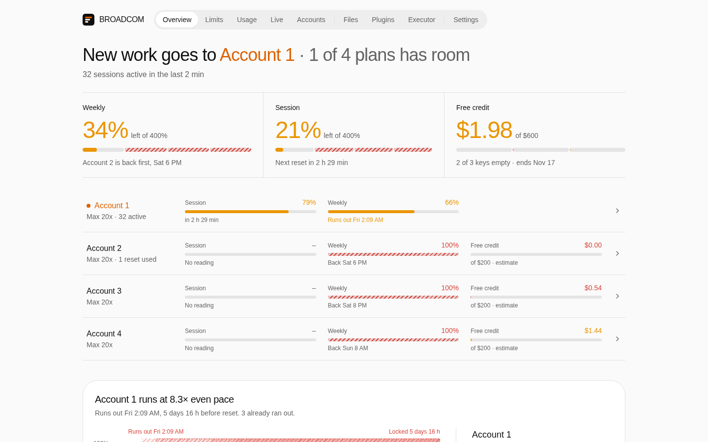
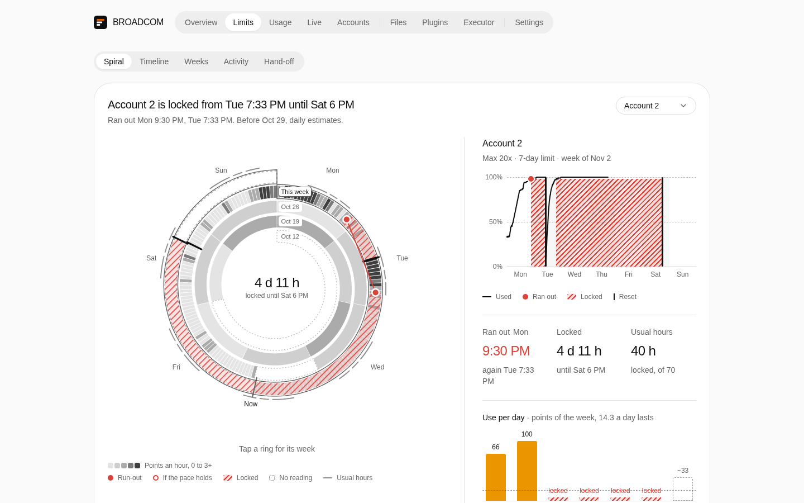
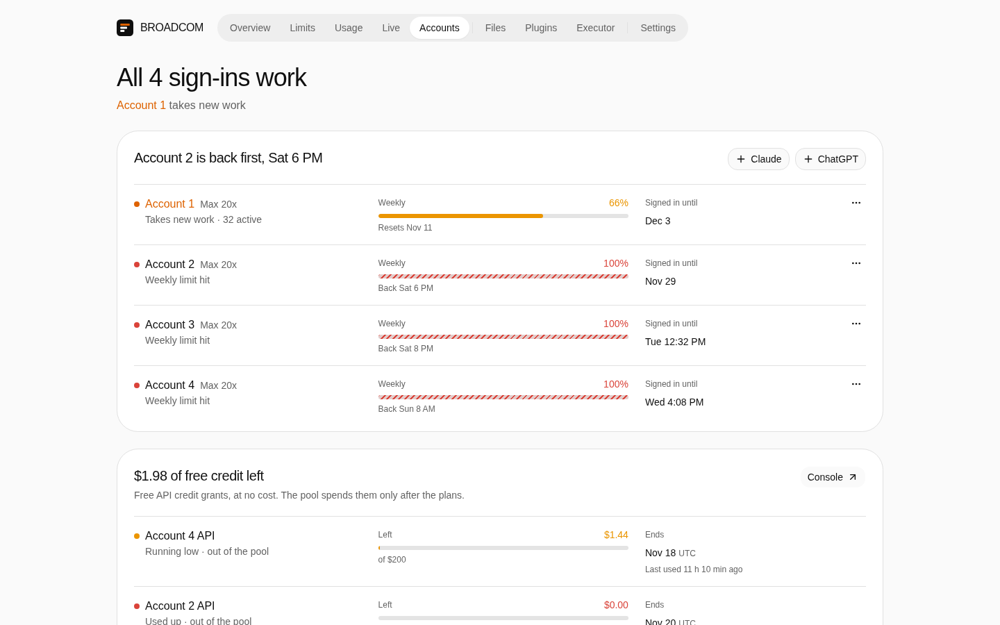

# BROADCOM

A dashboard for a [CLIProxyAPI](https://github.com/router-for-me/CLIProxyAPI) account pool: where new work goes, what every plan and free API credit has left, how fast it's being spent, and by whom.

<picture>
  <source media="(prefers-color-scheme: dark)" srcset="docs/screenshots/overview-dark.png">
  
</picture>

<table>
  <tr>
    <td width="50%"><picture>
        <source media="(prefers-color-scheme: dark)" srcset="docs/screenshots/limits-dark.png">
        
      </picture></td>
    <td width="50%"><picture>
        <source media="(prefers-color-scheme: dark)" srcset="docs/screenshots/accounts-dark.png">
        
      </picture></td>
  </tr>
  <tr>
    <td align="center">Limits</td>
    <td align="center">Accounts</td>
  </tr>
</table>

Next.js 16, shadcn on Base UI, Tailwind 4, Effect 4.

```sh
bun install
BROADCOM_PROXY=http://127.0.0.1:8317 bun run dev
```

`BROADCOM_KEY_FILE` points at the proxy's management key (default `~/.config/cliproxyapi/key`). The key stays on the server.
